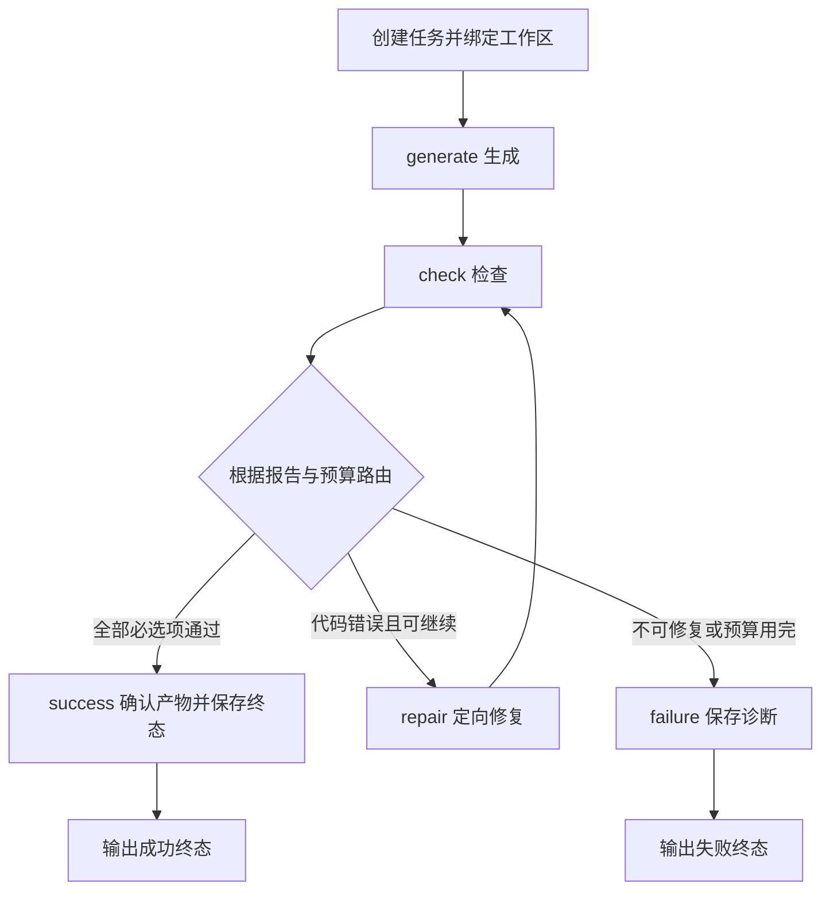

# Spring AI Alibaba Graph 质量检查与自动修复开发跟踪

创建日期：2026-11-17。最后更新：2026-11-18。

本次交付：开发方案、进度跟踪文档及 S01 最小 Graph 原型。真实业务闭环、数据库变更和 Maven 集成验证尚未开始。

## 1. 已确定的需求与目标

采用 **Spring AI + Spring AI Alibaba Graph**，为当前单体项目的 Vue 工程生成增加真实质量检查与自动修复闭环。

- Spring AI：继续负责 OpenAI 兼容模型调用、流式输出和文件工具调用。
- Graph：负责生成、检查、修复节点的执行顺序、任务状态和条件路由。
- 业务 Service：继续承载实际生成、文件操作、构建、诊断和报告保存能力，节点调用这些能力。
- 前端：展示生成、检查、修复进度与最终结果；只有任务成功才能刷新为本轮预览。

首要目标是：生成代码后执行真实检查；对可修复的代码错误自动反馈给 AI，定向修改并复检；达到上限或出现检查环境异常时明确失败，保留完整过程。

本方案不要求将所有业务拆成节点。登录、应用归属校验、应用列表、下载等仍在原有业务层中；一次模型任务内部的文件工具循环先整体复用，不把每次文件读取或写入拆成 Graph 节点。

### 1.1 范围与里程碑

| 里程碑 | 交付目标 | 包含内容 | 完成条件 |
| --- | --- | --- | --- |
| M0：接入基础验证 | 确认 Graph 版本、状态路由与实时输出适配可行 | S01～S03；不要求调用真实模型 | 锁定候选依赖版本；状态与条件路由原型通过；已有生成事件可以实时向前端转发 |
| M1：构建检查与修复闭环 | Vue 工程构建失败后可自动修复，过程可查看 | S04～S12；包含任务文件隔离、检查、修复、报告、页面进度与定向验证 | 真实构建诊断驱动修复；轮数有界；失败不发布半成品；前端收到准确终态 |
| M2：浏览器运行检查 | 在构建通过后发现运行异常，并纳入修复闭环 | S13～S14 | 能区分编译通过与运行正常；浏览器异常有证据；整体回归完成 |

M1 完成可以标记为“构建质量检查与自动修复已完成”，不能表述为“页面运行检查也已完成”。本次完整功能计划以 M2 验收为结束。

暂不纳入：微服务版本、完整用户版本管理、多人协作、可视化流程编辑器、多 Agent 角色体系、视觉美观评分、全面漏洞扫描、自动部署、跨进程断点续跑。HTML 和多文件模式保持原有生成行为，作为回归项。

### 1.2 默认业务规则

| 规则 | 本次要求 |
| --- | --- |
| 支持类型 | 第一版闭环只接入 `vue_project` |
| 修复预算 | 首次检查不计修复次数；默认最多启动 2 次修复，最多形成 3 次检查；允许配置，零次表示只检查 |
| 成功判定 | 本里程碑所有必选检查通过，且本轮产物确认、报告保存成功；模型回复“已完成”不构成成功 |
| 可修复问题 | 工程文件缺失、语法错误、导入错误等具有明确诊断的代码问题；M2 扩展到可归因的运行问题 |
| 检查异常 | 依赖下载网络失败、构建执行环境缺失、浏览器启动失败等，不自动当成源码问题修复 |
| 无进展 | 本轮无有效源码变更，或同一诊断重复出现且无可验证进展时，提前结束并说明原因 |
| 任务期限 | 配置整体截止时间及模型、构建、浏览器阶段超时；达到期限停止后续操作 |
| 取消 | SSE 断开或主动取消后停止任务，不后台继续改文件；保留取消前的记录 |
| 互斥 | 单实例内，同一应用的生成、检查、修复及产物确认全程互斥；部署不得同时读写正在变更的工程 |
| 文件隔离 | 失败任务不能覆盖上一轮可用预览；只确认并发布本次检查对应的产物 |
| 流式体验 | AI 正文、工具事件、检查与修复进度实时输出；节点完成事件不能代替模型正文流 |

这些规则是待实现的目标，不代表当前代码已经满足。

## 2. 官方文档与版本证据

实施每一步前，先阅读相关官方资料，并核对最终选定版本的 API 与项目代码。网页示例与所选发布版本不一致时，以该版本的官方源码、发布说明与实际验证为准。

| 编号 | 官方资料 | 本次用途 | 2026-11-17 核对结果 |
| --- | --- | --- | --- |
| D01 | [Graph 快速开始](https://java2ai.com/docs/frameworks/graph-core/quick-start/) | 状态、节点、条件边、状态合并策略 | 文档提供 `StateGraph`、`OverAllState`、`NodeAction`、`addConditionalEdges`、`ReplaceStrategy`、`AppendStrategy` |
| D02 | [版本说明](https://java2ai.com/docs/versions) | 确认 SAA、Spring AI、Boot 对应关系 | 官方表列出 SAA 1.1.2.0 对应 Spring AI 1.1.2、Boot 3.5.x；Boot 小版本仍需结合 BOM/POM 核对 |
| D03 | [Graph 中的 Spring AI 流式集成](https://java2ai.com/docs/frameworks/graph-core/examples/llm-streaming-springai) | 验证节点内模型流和图输出如何衔接 | 官方有流式集成示例；现有自定义工具事件、取消传播仍需项目原型验证 |
| D04 | [Graph 持久化示例](https://java2ai.com/docs/frameworks/graph-core/examples/persistence) | 区分图检查点与业务报告保存 | 实施前阅读；不因保存业务报告就宣称具备断点恢复 |
| D05 | [Spring AI ChatClient](https://docs.spring.io/spring-ai/reference/api/chatclient.html) / [工具调用](https://docs.spring.io/spring-ai/reference/api/tools.html) | 保持 Spring AI 模型和文件工具边界 | 实施 S05、S07 前结合 1.1.2 版本核对 |
| D06 | [SAA 官方发布记录](https://github.com/alibaba/spring-ai-alibaba/releases) | 核对候选版本变更与模块发布情况 | S01 阅读并记录最终采用的发布版本 |

当前根 `pom.xml`：Java 21、Spring Boot 3.5.7、Spring AI 1.1.2，使用 `spring-ai-starter-model-openai`。

**候选基线：SAA 1.1.2.0 + Spring AI 1.1.2 + Boot 3.5.7。**官方 BOM 和 Maven Central 元数据已确认 Graph 模块坐标为 `com.alibaba.cloud.ai:spring-ai-alibaba-graph-core:1.1.2.0`；源码 API 以该版本 JAR 核对通过。项目已接入最小 Graph Core 依赖，不引入无关模型 Starter、Studio 或整套 Agent Framework。Maven 依赖解析、项目编译和测试执行仍待本次具体授权。

本方案继续使用现有 OpenAI 兼容接口，无需因使用 Graph 更换到 DashScope。只有确有需要的组件才加入依赖。

## 3. 当前代码基线

以下为源码静态核对结果，不是运行验证结果。

| 位置 | 当前职责或行为 | 本次衔接点 |
| --- | --- | --- |
| `controller/AppController.java` | `/app/chat/gen/code` 包装 SSE；上游正常完成后追加 `done` | 区分任务成功与失败，避免失败节点正常结束后误发 `done` |
| `service/impl/AppServiceImpl.java` | 参数、应用归属校验、用户消息保存、监控标签；部署时再次调用构建器 | 进入新流程；部署与生成协调；保留现有权限规则 |
| `core/AiCodeGeneratorFacade.java` | Vue 模型流结束后执行一次构建，失败抛异常 | 将 Vue 生成和检查的编排交给 Graph；避免重复构建或递归进入整个门面 |
| `ai/springai/SpringAiCodeGenerator.java` | Spring AI 流式模型调用、手动文件工具循环、应用级 JVM 互斥 | 复用调用能力；任务锁扩大至完整流程；处理上下文保存边界 |
| `ai/springai/SpringAiToolCallbacks.java` | 为服务端 `appId` 创建工具回调 | 扩展为服务端绑定任务工作区，修复采用受限工具集合 |
| `ai/common/ProjectFileOperations.java` | 路径校验；文件工具绑定应用 Vue 工程目录 | 复用路径防护，适配任务级工作目录，不允许模型自行选择根路径 |
| `core/builder/VueProjectBuilder.java` | 安装依赖、构建、检查 `dist`；仅返回布尔结果 | 增加详细构建结果、受控命令、日志采集、超时及进程终止 |
| `core/handler/JsonMessageStreamHandler.java` | 将模型和工具 JSON 事件转换成文本；未知类型抛错 | 不能直接混入质量事件；新增明确的事件适配与历史保存规则 |
| `ai/springai/SpringAiConversationRepository.java` | Redis 模型消息保存与历史回填；模型流结束即保存 | 区分模型轮次完成与产物通过，保持修复后的上下文与实际文件一致 |
| `utils/ScreenshotDriverFactory.java` | 创建独立的 Selenium 浏览器会话 | M2 复用创建能力，并增加错误采集及就绪判断 |
| `zzx-ai-code-frontend/src/pages/app/AppChatPage.vue` | 处理文本、`business-error`、`done`；`done` 后刷新预览 | 增加质量进度、轮次报告与准确终态处理 |
| `langgraph4j/` | 旧学习工作流有 AI 审查反馈修复，生成使用固定应用 ID；HTTP 方法映射已注释 | 仅作为流程参考，继续保留，不作为新主业务入口 |

后端上述包路径均相对于 `src/main/java/com/zzx/zzxaicode/`。

## 4. 目标设计

### 4.1 调用链与节点边界

```text
AppController
  -> AppServiceImpl（既有鉴权与输入校验）
  -> AiCodeGeneratorFacade（按类型分派）
       -> HTML / 多文件：既有路径
       -> Vue：Graph 执行服务
            -> generate：调用已有 Spring AI 生成与文件能力
            -> check：调用真实检查服务，返回 QualityReport
            -> repair：调用 Spring AI 定向修复
            -> success / failure：保存终态与报告
  -> SSE 事件适配与用户可见历史
  -> 前端进度、报告、成功预览
```



取消和未预期异常由执行服务统一处理，不假设它们一定经过 `failure` 节点。两条路径也必须保存相应终态并释放实际持有的资源。

### 4.2 状态与资源边界

| 状态键 | 含义 | 更新要求 |
| --- | --- | --- |
| `taskId`、`appId`、`userId` | 服务端任务及归属标识 | 初始化后不可由模型或后续节点改写 |
| `originalRequirement`、`generationType` | 原始需求与类型 | 本次任务固定 |
| `workspaceId`、`artifactId` | 服务端工作区及产物引用 | 只接受经过服务端校验的引用 |
| `stage`、`finalStatus` | 当前阶段与任务终态 | 覆盖；终态只允许一次成功转换 |
| `repairAttempts`、`maxRepairAttempts` | 已启动及允许启动的修复次数 | 启动修复前增加；不与工具循环轮数混用 |
| `deadline` | 本轮整体截止时间 | 固定；各阶段仍需独立超时 |
| `qualityReport` | 最新检查报告 | 替换为最新报告 |
| `repairRecords` | 每轮修改与诊断摘要 | 追加本轮增量，避免把历史全集重复追加 |

每次任务拥有独立状态及 Graph 执行标识，不能仅用 `appId` 让不同生成任务误共享检查点。节点通过框架状态更新机制返回数据，避免多个节点原地修改同一可变集合。

Service、数据库连接、浏览器、进程、SSE 连接和事件发送器属于执行资源，不写入需要序列化的图状态。ChatMemory 保存模型对话，不作为修复次数或成功状态的事实来源。

### 4.3 报告与终态语义

- 检查项状态：`PASSED`、`FAILED`、`ERROR`、`TIMEOUT`、`SKIPPED`；跳过的必选项不能算通过。
- 任务状态：`RUNNING`、`SUCCEEDED`、`FAILED`、`CANCELLED`、`INTERRUPTED`。
- 问题记录：阶段、错误分类、是否可修复、相对文件路径、可用的行列号、摘要、日志引用；无法准确提取位置时保留诊断，不虚构行号。
- 预期构建失败是检查数据，不能在收集报告前直接中断流程；未预期程序异常不能被统一转换成“请 AI 修代码”。
- 同一任务只产生一个终态；保存失败、取消、重复回调不能造成先成功后失败或重复成功事件。
- 第一版业务报告落库；Graph 检查点选型在 S01 记录。内存检查点不提供进程重启后的恢复能力，本次不承诺自动续跑。

## 5. 开发进度总表

状态说明：`已完成`、`未开始`、`进行中`、`待验证`、`阻塞`。代码编写完成但未满足验证条件时，标记“待验证”，不能标记“已完成”。

| 步骤 | 需求与目标 | 前置依赖 | 状态 | 完成证据 |
| --- | --- | --- | --- | --- |
| S00 | 确认方案范围、官方资料和当前代码基线，建立跟踪文档 | 无 | 已完成 | 本文第 1～4 节；仅完成文档与静态核对 |
| S01 | 锁定 Graph 依赖并验证最小状态路由 | S00 | 已完成 | Java 21 + Maven 项目编译与 Graph 原型运行通过，任务隔离断言通过；不配置检查点，以 taskId 区分任务，不承诺重启续跑 |
| S02 | 定义任务状态、报告及配置契约 | S01 | 已完成 | 任务/报告数据契约、Graph 合并策略、Spring 配置绑定与非法预算拒绝通过；业务轮次执行在 S08 验证 |
| S03 | 验证 Graph 与现有模型、工具事件的流式桥接 | S01、S02 | 已完成 | GraphEventBridgeTest 2 个测试通过：节点结束前收到事件、一次订阅、取消模型及异常传播；无需求时 ERROR，不无界缓存 |
| S04 | 实现任务工作区、全流程互斥和产物确认边界 | S02、S03 | 已完成 | QualityWorkspaceTest 3 个测试通过：失败隔离、指针发布/补偿、工具路径限制和租约所有权；主入口及部署锁在 S10 连接 |
| S05 | 将既有 Vue 生成能力接入生成节点 | S03、S04 | 已完成 | 工作区独立会话、受限工具、阶段期限和成功后保存；SpringAiProtocolTest 10 个测试通过（本地协议桩，非真实模型）；Graph 节点连接在 S08 |
| S06 | 实现真实构建检查及结构化诊断 | S02、S04 | 待验证 | 固定 Docker/Vite 命令、输出上限、超时回收、唯一候选与资源校验已实现；5 个定向测试通过，真实 Docker 工程验收归入 S12 |
| S07 | 实现受限的 Spring AI 定向修复 | S05、S06 | 未开始 | — |
| S08 | 连接 Graph 条件边及有界修复闭环 | S05～S07 | 未开始 | — |
| S09 | 保存任务与轮次报告，提供鉴权查询 | S02、S08 | 未开始 | — |
| S10 | 接入主业务与 SSE 终态，协调预览及部署 | S03、S08、S09 | 未开始 | — |
| S11 | 完成聊天页进度与报告展示 | S10 | 未开始 | — |
| S12 | 完成 M1 定向验证与演示 | S04～S11 | 未开始 | — |
| S13 | 增加浏览器运行检查并纳入修复闭环 | M1 已完成 | 未开始 | — |
| S14 | 完成 M2、旧模式回归与最终交付 | S13 | 未开始 | — |

## 6. 分步骤需求、目标与验收

### S01：依赖基线与最小 Graph 原型

- **需求**：引入适配现有 Spring AI 的 Graph 能力，并确认实际 API。
- **目标**：最小图能够执行节点、更新状态、走条件边并有界结束。
- **工作**：阅读 D01、D02、D06；核对发布模块坐标、BOM 与传递依赖；使用假节点构建“检查失败 → 修复一次 → 检查通过”的原型；明确检查点和执行标识策略。
- **范围与产出**：根 `pom.xml`、最小图原型、版本决策记录；优先保持 Java 21、Boot 3.5.7 和 Spring AI 1.1.2。
- **已完成的开发产出**：根 `pom.xml` 引入 `com.alibaba.cloud.ai:spring-ai-alibaba-graph-core:1.1.2.0`；新增 `quality/graph/QualityCheckGraphPrototype`，用 `StateGraph`、`OverAllState`、替换策略和条件边构造“首次检查失败 → 修复一次 → 再检查通过”的最小闭环；新增任务隔离和计数断言。
- **当前验证结果**：已使用官方 1.1.2.0 JAR 对原型进行 `javac` 静态编译，结果通过；曾尝试用本地缓存 JAR 拼接 classpath 运行，但因缓存中 Spring Boot/Logback 版本冲突在 Graph 初始化阶段失败，该结果不能替代项目 Maven 验证。尚未执行 Maven 依赖解析、项目编译和 JUnit。由于项目工作流禁止未经具体授权的 Maven 操作，依赖无冲突、项目级编译和实际 Graph 运行输出仍标记待验证。
- **验收**：记录所选 Graph 精确版本及坐标；依赖无冲突、能够编译；不同任务状态互不干扰；记录实际运行输出。官方兼容表不能代替这些验证。
- **执行边界**：Maven 操作需获得本次具体授权；未授权前可完成资料与源码核对，解析、编译和 Maven 测试保持待验证，不通过 IDE 或脚本绕过。

### S02：状态、报告和配置契约

- **需求**：图中所有步骤使用统一、可解释的任务数据。
- **目标**：检查、修复、SSE 和报告保存对状态与计数含义一致。
- **工作**：按第 4 节定义状态键、合并策略、问题模型和终态；建立任务与检查轮次关联；定义模型轮数、修复轮数、总期限和各阶段超时的独立配置；校验负数及无效组合。
- **范围与产出**：项目 DTO、枚举、Graph 状态策略、配置类及契约说明。Graph 类型限制在编排层，不传到 Controller、前端或业务表字段。
- **已完成的开发产出**：新增任务阶段/终态、检查项状态、问题分类、问题记录、检查报告、修复记录和任务状态模型；新增 Graph 状态键与替换/追加策略；新增 `app.quality` 配置，分别约束修复次数、模型工具轮数、整体截止时间及模型/构建/浏览器阶段超时。
- **边界实现**：必选检查项只有明确 `PASSED` 才能使报告通过；首次检查轮次允许且固定从 0 开始；修复次数独立于模型工具轮数；报告与任务状态只保存可序列化业务数据；重复追加同一修复记录保持历史不变。
- **当前验证结果**：已使用本地依赖的 `javac -proc:none -Xlint:all` 编译新增主代码和测试代码，编译退出码为 0；另用独立 Java 驱动运行纯数据契约反例，确认报告通过判定和路径校验；尚未执行 Maven 依赖解析、JUnit 或 Spring Boot 启动校验，因此 S02 仍为待验证。
- **验收**：首次检查为第 0 轮、两次修复最多三次检查；追加历史不重复；必选项 `SKIPPED/ERROR` 不会通过；配置零次修复时正确终止；报告可序列化且不包含执行资源。

### S03：流式桥接技术验证

- **需求**：接入 Graph 后继续实时展示 AI 正文及文件工具执行过程。
- **目标**：确定现有 `Flux` 与所选 Graph 版本的流式衔接方式，先解决集成风险。
- **工作**：阅读 D03；用假模型和延迟片段验证正文、工具请求、工具结果、节点进度的顺序；确定订阅关系、背压、缓冲上限和取消传播；明确质量事件从普通文本链路分流的位置。
- **范围与产出**：流式适配原型和事件契约；复用现有模型协议聚合，不另造模型流解析器。
- **验收**：生成尚未结束时前端已收到片段；一次请求只执行一次生成；异常和取消不被吞掉；缓冲不会无限增长；不通过 `collectList/blockLast` 等待全量内容后才输出。
- **门槛**：S03 未验证通过前，不把 Graph 直接替换到主生成入口。

### S04：任务工作区、互斥与失败隔离

- **需求**：检查和修复操作不得影响其他任务，也不能把失败产物展示为本轮成功结果。
- **目标**：同一应用只有一个有权写入的任务，检查报告绑定确定的源码和产物。
- **工作**：为任务分配服务端工作区，从已有源码准备本轮输入；文件工具绑定任务目录并沿用路径校验；构建输出使用本轮独立产物标识；覆盖全流程的应用互斥；设计成功产物发布及异常补偿；协调部署对工程的访问。
- **范围与产出**：任务执行服务、工作区能力、`ProjectFileOperations` 与工具绑定适配；确定并记录预览路径映射与成功产物确认顺序。
- **验收**：同应用并发请求被明确拒绝或按既定规则处理，不能抢占或释放别人的锁；不同应用可独立运行；失败任务保留上一轮可用预览；模型无法越权设置 `appId/taskId` 或访问其他工作区；旧 `dist` 不会被识别为本轮产物。
- **约束**：先保证单实例行为，不宣称分布式互斥。成功产物切换与数据库保存不是天然原子操作，必须说明失败补偿。失败工作区先保留，不添加批量清理、目录删除或通配符删除命令。

### S05：生成节点

- **需求**：复用现有 Spring AI 生成和文件工具机制。
- **目标**：`generate` 节点完成一次模型生成及文件落盘，并返回可供检查的工程引用。
- **工作**：拆开现有门面中“生成后立即构建”的编排；生成节点调用既有能力；调整任务工作区与模型上下文入口；保留工具调用、监控标签与模型异常传播。
- **范围与产出**：新 Graph 生成节点及执行服务；必要调整 `AiCodeGeneratorFacade`、`SpringAiCodeGenerator`、工具回调和上下文保存边界。
- **验收**：首次生成保留实时文本和工具事件；文件写入本任务目录；节点不会额外触发一次构建；模型失败不进入后续正常检查；没有重复保存用户消息或工具消息。

### S06：真实构建检查

- **需求**：将当前构建布尔结果升级为能够驱动修复的实际诊断。
- **目标**：`check` 节点准确判断工程、构建与产物状态，并区分代码失败和执行环境异常。
- **工作**：扩展 `VueProjectBuilder` 返回详细结果；持续读取 stdout/stderr；设置输出大小、阶段及总超时；终止进程及相关子进程；校验入口与引用资源；分类错误并保留原始日志引用。
- **范围与产出**：详细构建结果、工程检查及诊断提取；兼顾既有部署调用，必要时保留布尔方法作为适配。
- **验收**：语法错误和缺失导入可定位到实际诊断；安装失败不一概归为代码问题；退出码为零但没有本轮有效产物时失败；大量输出不阻塞；超时不会留下持续执行的构建进程。
- **执行要求**：构建命令由平台固定，不能由模型提供任意 shell 文本。生成的依赖脚本与构建脚本仍是不可信执行内容，须使用受限执行环境和资源、网络边界；不能把超时等同于完整隔离。

### S07：定向修复节点

- **需求**：根据真实检查证据修复代码，保留原始需求。
- **目标**：`repair` 节点完成一轮可审计、范围受限的文件变更，并交回检查节点。
- **工作**：阅读 D05；提供原始需求、诊断摘要、相关源码、必要配置和上一轮结果；复用手动工具循环；记录变更清单与前后指纹；限制模型请求和工具轮数；单独统计修复预算。
- **范围与产出**：修复服务、修复提示词、受限工具集合、每轮记录；提示词不承担唯一安全约束，文件范围与关键操作由服务端约束。
- **验收**：能针对语法和导入错误产生有效修改；不能通过清空页面、关闭检查、伪造 build 脚本宣称修复；无变化可识别；工具失败如实记录；不递归调用完整生成门面；模型完成后必须复检。
- **边界**：修复默认使用读取、写入、修改工具，不开放目录或批量删除。修改依赖及构建配置时采用明确策略，不能仅凭模型自行决定取消检查。

### S08：Graph 闭环与终止策略

- **需求**：用状态与条件边连接生成、检查和修复。
- **目标**：图能按实际结果成功退出、失败退出或取消，循环有界且原因可追踪。
- **工作**：创建 `generate/check/repair/success/failure` 节点；定义检查后的条件边；实现修复计数、诊断指纹、无进展判断及截止时间；统一处理节点异常和资源释放。
- **范围与产出**：Graph 定义、路由函数、执行服务、阶段事件。
- **验收**：通过直接成功；可修复错误进入修复；检查环境异常不进入源码修复；达到上限和整体超时正确失败；取消不会继续下一节点；终态仅一次。
- **区别**：工具循环上限、质量修复次数和 Graph 引擎递归限制分别配置；引擎限制作为保护，不能替代业务修复计数。不用 Reactor `retry` 重订阅整个生成流程代替自动修复。

### S09：报告保存与查询

- **需求**：页面刷新后可查看任务结果和每轮诊断。
- **目标**：一次生成、每次检查和每轮修复能够准确关联。
- **工作**：设计最小任务表及轮次记录（名称实施时统一），增加相应 PO、Mapper、Service 和查询接口；日志、截图保存引用；校验应用归属和查询权限；建立失败与取消记录。
- **范围与产出**：SQL 变更脚本、模型、报告服务、接口定义；创建脚本不等于已执行数据库变更。
- **验收**：最终报告包含首轮结果、修复次数、各轮问题、修改文件、耗时和产物引用；其他用户无法越权查询；敏感配置和无关绝对路径不对外暴露；重复终态回调不重复新增轮次。
- **恢复语义**：进程重启后未结束的本实例任务可标记 `INTERRUPTED`，不直接标成成功或自动重放文件工具；报告持久化与 Graph 续跑分开描述。

### S10：主业务与 SSE 接入

- **需求**：当前聊天入口实际使用闭环，前端能判断准确结果。
- **目标**：Graph 内部状态不穿透业务协议，成功、失败与取消不会混淆。
- **工作**：Vue 分支进入新流程；引入项目事件 DTO 和 SSE 适配；模型正文保留既有展示能力；质量事件独立传输；调整 `JsonMessageStreamHandler` 和历史保存规则；部署读取确认过的工程或受同一互斥保护。
- **建议事件**：`quality-started`、`quality-check-result`、`repair-started`、`repair-completed`、`quality-finished`；最终命名在 S03 冻结。`done` 仅表示成功终态，失败使用明确错误事件。
- **验收**：失败节点正常返回不能触发控制器无条件追加 `done`；异常与失败不刷新为本轮预览；断连取消一路传播到模型和构建；日志不混入普通 AI 正文；报告保存、历史保存与 SSE 发送顺序有明确失败处理。
- **约束**：若持有进程尚未终止，不提前释放写入资格让下一任务覆盖目录。对前端不得暗示 Graph 节点结束就代表整个应用已生成成功。

### S11：聊天页进度与报告

- **需求**：用户能看懂当前正在生成、检查还是修复，以及最终失败原因。
- **目标**：不阅读服务器日志也能完成演示和基本排查。
- **工作**：增加阶段进度、首轮结果、修复轮次、问题列表、修改文件和报告入口；页面重载后查询任务报告；不同任务事件按 `taskId` 归属；保留现有 SSE 错误关闭逻辑。
- **范围与产出**：聊天页面及必要组件、API 类型和调用；若接口代码由 OpenAPI 生成，沿用项目生成约定，不顺带覆盖其他接口。
- **验收**：成功后刷新本轮预览；失败保留上一可用预览及失败报告；页面切换后不接收迟到事件；旧任务终态不能覆盖新任务；质量报告可独立查看；EventSource 异常重连不自动重复生成。

### S12：M1 验证与演示

- **需求**：用实际故障条件证明构建检查和自动修复有效。
- **目标**：完成第 7 节 M1 用例，形成可复核记录。
- **工作**：定向测试路由、状态、计数、文件隔离和事件终态；执行受控 npm 构建样例；使用固定模型配置验证至少一次真实自动修复；检查既有生成和部署衔接。
- **范围与产出**：相关测试、构建日志、任务报告、演示步骤及结果记录。
- **验收**：各必选用例有实际结果；明确哪些为模拟、真实构建、真实模型；正常工程不被无故修复；失败、取消与上限准确；没有遗漏的必要验证才标记 M1 完成。

### S13：浏览器运行检查

- **需求**：发现构建通过但页面无法正常运行的问题。
- **目标**：将浏览器运行证据加入同一检查报告和修复闭环。
- **工作**：阅读所选 Selenium 版本官方资料；复用浏览器创建能力；检查前注入或启用异常采集，覆盖首屏脚本；打开本轮唯一产物 URL 并禁用缓存；设置就绪条件；采集未捕获异常、关键资源失败与截图。
- **范围与产出**：浏览器检查服务、检查规则、运行证据和修复上下文适配；首版限定受控首屏，不宣称覆盖所有交互。
- **验收**：构建通过但首屏抛错会失败；关键本地资源缺失可定位；浏览器无法启动归为检查环境异常；无头浏览器最终释放；外部图片失败与疑似空白按公开规则处理，不能仅凭截图断言功能正确。
- **约束**：页面可访问不代表需求全部满足；未交互到的页面和功能不能标记已测通过。测试 URL 由服务端产物引用构造，不能开放任意 URL 探测。

### S14：整体回归与交付

- **需求**：确保新能力在主业务可用，并保持原有模式和关键边界。
- **目标**：M2 用例及必要回归完成，文档、代码、运行结果一致。
- **工作**：补齐真实浏览器与真实模型组合验证；回归 HTML、多文件、Vue、应用归属、预览、部署、取消和报告查询；检查所有新增代码注释、配置及差异；更新本文结果和限制。
- **范围与产出**：最终验收记录、配置说明、演示清单和已知边界。
- **验收**：M1、M2 必选用例完成；不把静态检查或模拟结果表述为真实环境通过；源码、报告和预览产物能够对应；仅交付本次相关改动。提交和推送按后续实际授权执行。

## 7. 验证矩阵

以下均为待执行计划。建议优先编写能证明路由、诊断、取消和文件隔离的定向测试，不堆砌仅复述实现的测试。

| 编号 | 阶段 | 输入或特殊条件 | 预期结果与判定依据 | 计划验证方式 | 实际结果 |
| --- | --- | --- | --- | --- | --- |
| T01 | M0 | 假检查首轮失败、修复后通过 | 节点按预期执行；修复 1 次、检查 2 次 | 图执行测试 | 未执行 |
| T02 | M0 | 模型分多段输出且带工具事件 | 结束前可收到片段；事件不丢、不重复 | 假模型流式集成 | 未执行 |
| T03 | M1 | 正常可构建 Vue 工程 | 首轮通过，修复次数为 0 | 真实 npm 构建 | 未执行 |
| T04 | M1 | Vue 模板语法错误 | 收到实际编译诊断；修复后重新构建通过 | 真实构建 + 真实模型 | 未执行 |
| T05 | M1 | 导入不存在的组件 | 诊断包含真实导入问题；修复符合原需求 | 真实构建 + 真实模型 | 未执行 |
| T06 | M1 | 两轮修复后仍失败；另测配置 0 次 | 默认最多三次检查；零次不调用修复；均无成功事件 | 图测试 + 定向集成 | 未执行 |
| T07 | M1 | 模型无文件变更或重复无进展 | 提前失败并记录原因，不能无限循环 | 受控修复结果 | 未执行 |
| T08 | M1 | 依赖下载失败或 npm 不存在 | 报告执行环境异常，不调用源码修复 | 受控执行器故障 | 未执行 |
| T09 | M1 | 进程超时、大量输出或用户取消 | 有界结束；输出不堵塞；子进程终止后才允许新写任务 | 受控子进程集成 | 未执行 |
| T10 | M1 | 旧 `dist` 存在，本轮失败或缺产物 | 不误判成功，报告绑定本轮产物 | 真实构建样例 | 未执行 |
| T11 | M1 | 同应用并发、不同应用并发 | 同应用互斥；不同应用不串状态、上下文、文件 | 并发集成 | 未执行 |
| T12 | M1 | 已有可用预览，新任务修复失败 | 旧预览仍可用；失败工作区不发布 | 文件与预览集成 | 未执行 |
| T13 | M1 | 越权应用、报告查询或路径穿越 | 服务端拒绝，不返回其他应用内容 | 权限与文件测试 | 未执行 |
| T14 | M1 | 正常失败节点返回、断流、迟到事件 | 失败不追加 `done`；不刷新失败产物、不重复启动 | SSE 与前端验证 | 未执行 |
| T15 | M1 | 新流程之外的 HTML、多文件生成 | 保持既有文本、落盘和预览行为 | 相关回归 | 未执行 |
| T16 | M1 | 检查报告落库失败、产物确认失败 | 不向用户宣告成功；补偿规则有证据 | 故障注入集成 | 未执行 |
| T17 | M2 | 构建成功但首屏 JS 抛错 | 浏览器捕获错误，进入有预算的修复 | 真实浏览器 | 未执行 |
| T18 | M2 | 关键资源 404、浏览器启动失败 | 前者按规则失败；后者为环境异常 | 真实浏览器 + 故障注入 | 未执行 |
| T19 | M2 | 页面有意无文本、外部图片失败 | 按公开规则处理，不把所有 console/error 都当源码缺陷 | 浏览器反例样例 | 未执行 |
| T20 | M2 | 旧缓存、预览路径、部署与生成竞争 | 检查访问本轮产物；部署不读取半成品 | 真实预览与部署回归 | 未执行 |

真实模型结果具有波动性：固定模型 ID、关键参数、提示词、任务样例和修复预算，保留实际输出；单次成功不代表对所有代码错误保证成功。测试调用不使用未经许可的业务外部副作用。

Maven 解析、编译和测试尚无本次执行授权；需要时记录具体命令与授权范围，未执行项保留待验证。本次编写文档不授权运行模型调用、构建、数据库变更或部署。

## 8. 进度维护与完成定义

每完成一个步骤，更新第 5 节对应行，并填写以下记录。只记录可核对事实，不用“已实现”代替验证结果。

| 更新日期 | 步骤 | 状态变化 | 相关文件或提交 | 实际验证方式与结果 | 剩余问题及下一步 |
| --- | --- | --- | --- | --- | --- |
| 2026-11-17 | S00 | 未开始 → 已完成 | 本文 | 阅读官方 D01～D03，静态核对当前主链路与依赖；没有编码或运行验证 | 从 S01 开始；D04～D06 按对应步骤补充阅读与版本记录 |
| 2026-11-18 | S01 | 未开始 → 待验证 | `pom.xml`、`QualityCheckGraphPrototype.java`、`QualityCheckGraphPrototypeTest.java` | 阅读官方版本表、Graph 快速开始和 BOM；确认坐标；使用官方 1.1.2.0 JAR 完成原型 `javac` 编译；本地拼接 classpath 运行因 Boot/Logback 版本冲突失败；未执行 Maven、JUnit 或真实模型 | 取得 Maven 操作授权后执行依赖解析、项目编译和原型运行；根据结果决定是否锁定 S01 并进入 S02 |
| 2026-11-18 | S02 | 未开始 → 待验证 | `quality/model`、`QualityGraphStateContract.java`、`QualityCheckProperties.java`、`QualityContractTest.java` | 使用本地依赖完成新增主代码与测试源码 `javac -proc:none -Xlint:all` 编译，退出码为 0；独立 Java 驱动验证报告通过判定和路径校验；未执行 Maven、JUnit 或 Spring Boot 启动 | 取得 Maven 操作授权后执行项目级测试和配置绑定校验；根据结果冻结契约并进入 S03 |

单步完成必须同时具备：需求对应的代码或文档产出、相关边界处理、适当验证证据，以及本表更新。缺少运行证据时明确标记“待验证”；授权不足导致无法执行必要检查时记录具体阻塞，不伪报完成。

完整功能交付清单：

- [ ] S01 锁定依赖及 API，完成实际接入验证。
- [ ] S02～S03 状态契约和实时流式桥接通过。
- [ ] S04 工作区、互斥、失败隔离与产物确认通过。
- [ ] S05～S08 真实检查与受限自动修复闭环通过。
- [ ] S09～S11 报告查询、SSE 与聊天页完成。
- [ ] S12 的 M1 必选用例通过并有演示证据。
- [ ] S13～S14 的浏览器检查及整体回归通过。
- [ ] 配置、日志、注释、已知限制及进度文档与交付一致。

## 9. 决策与待验证事项

S04 实测：`mvn.cmd -Dtest=QualityWorkspaceTest test`，3 个测试通过。任务位于输出目录 `.quality/apps/{appId}/tasks/{taskId}/source`；构建在各自任务目录产出 dist，不继承旧 dist。成功以 `published` 文件原子替换切换读取引用；记录旧指针用于报告终态落库失败时补偿，不声称文件系统和数据库原子事务。失败目录保留，不添加清理删除。公开预览仍用 `/static/vue_project_{appId}/dist/index.html`，S10 由服务端解析到当前确认目录，禁止公开内部任务目录。所有权租约覆盖全流程，S10 同时接入部署/下载。

S03 实测：`mvn.cmd -Dtest=GraphEventBridgeTest test` 通过。Graph 节点返回可取消 future，既有模型 JSON 字符串事件经单次订阅的执行上下文实时输出；图状态中不存 Flux、事件出口或订阅。普通文本链路在 S10 将质量事件分流为命名 SSE：`quality-started`、`quality-check-result`、`repair-started`、`repair-completed`、`quality-finished`。异常终态继续使用 error 信号，取消不启动后续节点。依据 D03 及 1.1.2.0 AsyncNodeAction 源码核对，未使用官方示例的全量 collectList 阻塞方式。

2026-11-18 最新验证：用户明确授权本次 Maven 解析、编译及相关定向测试。使用 Java 21 执行 `mvn.cmd -Dtest=QualityContractTest,QualityCheckGraphPrototypeTest test`，9 个测试全部通过；历史记录中“待授权/未执行”仅描述当时状态。检查点策略为不启用恢复检查点，taskId 使用服务端任务 UUID，业务报告独立持久化。补充核对 [Boot 3.5 配置绑定](https://docs.spring.io/spring-boot/3.5/reference/features/external-config.html) 和 [Graph 1.1.2.0 AppendStrategy 源码](https://github.com/alibaba/spring-ai-alibaba/blob/v1.1.2.0/spring-ai-alibaba-graph-core/src/main/java/com/alibaba/cloud/ai/graph/state/strategy/AppendStrategy.java)。

| 事项 | 当前结论 | 后续落点 |
| --- | --- | --- |
| 是否采用 Graph | 已确定，用于本次核心闭环编排 | S01～S08 |
| 是否重写全部业务 | 否，只调整必要的编排与执行边界 | S04、S05、S10 |
| Graph 精确依赖 | 已锁定 SAA Graph Core 1.1.2.0；官方 BOM、Maven Central 元数据和官方 API 示例均已核对 | S01 完成 Maven 解析与项目级验证后冻结 |
| Graph 状态与 ChatMemory | 分离；前者控制流程，后者提供模型上下文 | S02、S05、S07 |
| 实时流式接入 | 官方有支持；现有 JSON 工具协议与取消仍待验证 | S03 形成原型结论 |
| 检查点与恢复 | 第一版不承诺跨进程续跑，业务报告必须可查询 | S01、S09 |
| 任务工作区与成功预览映射 | 采用任务级隔离，精确路径与产物切换方案需在编码前固化 | S04 决策记录，S10 接入 |
| 浏览器检查 | 属于 M2，不作为 M1 已完成能力展示 | S13、S14 |

若后续改变范围、依赖或产物管理方案，先更新对应需求、步骤和验收条目，再继续开发。已有《毕业设计改造方案》主要描述框架迁移，本文件负责后续 Graph 质量闭环的开发跟踪；不据此恢复旧 LangGraph 学习接口。
